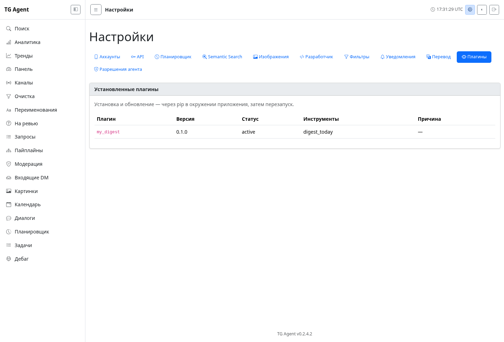

# Плагины

Плагин — обычный Python-пакет, который добавляет инструменты агенту и MCP.
Устанавливайте его **в то же Python-окружение**, где запущен TG Agent, затем
перезапускайте приложение. Публиковать отдельный или приватный репозиторий не нужно.

## Установка и обновление

```bash
# Опубликованный пакет (имя ниже — пример, а не существующий пакет)
pip install <имя-пакета>==<версия>
# Локальная разработка: работающий пример из этого репозитория
pip install ./examples/plugin_digest
# Или готовый wheel
pip install /path/to/plugin.whl
```

После перезапуска пример добавляет инструмент `digest_today`: до 100 сообщений,
собранных за последние 24 часа, без LLM-суммаризации и без живого Telegram.
Он доступен агенту и через `mcp-server`; разрешения находятся в существующей
странице настроек прав, в группе `Plugin: my_digest`.
Если ACL уже сохранён, новый инструмент получает обычные правила доступа ядра;
разрешите его в настройках перед использованием через standalone MCP.

Обновление: `pip install --upgrade <имя-пакета>` и перезапуск. Для отката установите
предыдущую версию и перезапустите. Данные при этом автоматически не откатываются:
перед обновлением сохраняйте резервную копию SQLite, если плагин меняет свои данные.
Удаление: `pip uninstall <имя-пакета>` и перезапуск.

Git URL, включая приватный репозиторий, можно передать самому pip при необходимости.
Приложение не хранит Git-ключи, не устанавливает пакеты и не обновляет их на лету.

## Написание плагина

Используйте [пример digest](https://github.com/axisrow/tg_content_factory/tree/main/examples/plugin_digest)
как минимальный устанавливаемый пакет. В `pyproject.toml` объявите entry point:

```toml
[project.entry-points."tg_agent.plugins"]
my_digest = "tg_plugin_digest:PLUGIN"
```

Имя entry point обязано совпадать с `Plugin.id` и соответствовать
`[a-z][a-z0-9_]*`. Публичные объекты импортируются из `tg_agent.plugin_api`:

```python
from tg_agent.plugin_api import Plugin, text_response, tool

def register(ctx):
    @tool("my_hello", "Приветствие", {}, category="read")
    async def hello(args):
        return text_response("Привет!")
    return [hello]

PLUGIN = Plugin(id="my_digest", version="0.1.0", requires_api=1, register=register)
```

`register(ctx)` синхронно возвращает список инструментов. Имена должны быть
уникальными среди ядра и всех плагинов. Категория обязательна: `read`, `write`
или `delete`. Необязательный `phone_bound=True` включает инструмент в каталог
прав конкретного аккаунта. Как и во встроенных инструментах, обработчик обязан
проверять выбранный телефон через `ctx.extras["tool_context"].require_phone_permission`
и доступность живого runtime через `require_live_runtime`; флаг сам по себе
не проверяет аргументы обработчика.

Автоматического подтверждения по категории нет — это конвенция каждого
обработчика. Инструменты с категорией `write`/`delete` вызывайте через гейт
`require_confirmation` из `tg_agent.plugin_api`: без `confirm=true` в аргументах
он возвращает предупреждение вместо выполнения, как у встроенных инструментов ядра:

```python
from tg_agent.plugin_api import require_confirmation, text_response, tool

@tool("my_reset", "Сбрасывает кэш плагина", {"type": "object"}, category="delete")
async def my_reset(args):
    if gate := require_confirmation("очистит кэш плагина", args):
        return gate
    ...
    return text_response("Кэш очищен")
```

Контекст содержит `db`, `client_pool`, `config`, `logger` с ID плагина и `extras`
с `tool_context`, `runtime_context`, `scheduler_manager`, `embedding_service`. Пул может отсутствовать
в MCP без пула, а в вебе он представляет snapshot, а не живой Telegram.

Опциональный `async setup(ctx)` выполняется до регистрации один раз на контейнер.
Создавайте свои таблицы с префиксом `plugin_<id>_`, не меняйте таблицы ядра.
Опциональный `async shutdown()` освобождает ресурсы до закрытия БД и пула;
он также вызывается после ошибки активации, поэтому должен переносить частичный
`setup`. На `setup` и `shutdown` отводится по 10 секунд: зависший колбэк
отменяется, плагин пропускается или фейлится с записью в лог, не блокируя
старт или остановку приложения. Для раздельных веба и воркера
жизненный цикл выполняется независимо: не храните их контексты в глобальных
переменных пакета; состояние обработчика держите в замыкании `register`.

## Отключение и диагностика

```yaml
plugins_disabled:
  - my_digest
```

После изменения конфигурации перезапустите приложение. Отключённый entry point
не импортируется. Несовместимый `requires_api` пропускается; ошибки загрузки,
инициализации или регистрации пишутся в лог, остальные плагины продолжают запуск.
Инструменты и права ошибочного плагина не публикуются частично.

Плагины — доверенный код с правами процесса. Перед установкой чужого пакета
просмотрите его код: импорт исполняется ещё до проверки версии API. Все зависимости
живут в одном окружении; их конфликты разрешаются обычными средствами pip.

## CLI и JSON API

Операция определяется в плагине один раз: её схема и обработчик используются
агентом, MCP, CLI и HTTP API. Новые интерфейсы вызывают только инструменты
активных плагинов, а не встроенные операции.

```bash
tg-agent plugin list
tg-agent plugin list --json
tg-agent plugin run digest_today --limit 5
# Живой Telegram нужен только при явном запросе:
tg-agent plugin run my_live_tool --with-pool --phone +1234567890
```

CLI генерирует флаги по свойствам схемы: `item_id` становится `--item-id`,
boolean — `--enabled` / `--no-enabled`. Массивы и объекты передаются JSON-значениями,
например `--items '[1,2]'`. Для сложных типов без единственного скалярного типа
тоже передавайте JSON-значение. Не переданные параметры не заполняются из
`default` схемы: действуют значения по умолчанию самого обработчика, как в MCP.
Внутридокументные `$ref` (включая `$defs` и цепочки ссылок), `allOf`, `anyOf`
и `oneOf` учитываются при построении флагов. Например, свойство
`title: {"$ref": "#/$defs/Text"}` с определением `Text: {"type": "string"}`
принимает `--title hello`; ссылка на boolean сохраняет пару положительного
и отрицательного флага. Nullable-типы требуют JSON: `--title '"hello"'`
или `--title null`. Ограничения всех ветвей проверяются по исходной схеме.
Рекурсивные объекты передавайте целиком как JSON. Ссылки разрешаются только
на ресурсы внутри переданной схемы, без загрузки внешних документов;
неразрешимая ссылка даёт ошибку схемы до вызова обработчика (HTTP 422).

`--help` показывает общую справку без импорта и запуска плагинов.
Имена свойств `help` и `with_pool`, а также конфликтующие имена флагов
не поддерживаются CLI; JSON API сохраняет исходные имена аргументов.

Результат обработчика печатается в stdout как JSON. Ошибки аргументов, ACL,
отсутствующего инструмента или runtime выводятся в stderr с ненулевым exit code.
По умолчанию CLI не открывает Telegram-пул. `--with-pool` использует обычную
инициализацию пула приложения, включая gateway, если он настроен.

```bash
curl -u ':WEB_PASS' -H 'Content-Type: application/json' \
  -d '{"limit":5}' http://localhost:8080/api/tools/digest_today
```

`POST /api/tools/{tool}` принимает объект аргументов и возвращает исходный
payload инструмента. Действуют обычные аутентификация и CSRF приложения:
при cookie-сессии отправляйте корректный same-origin `Origin`.
HTTP-коды: 404 — инструмент недоступен, 422 — неверные аргументы,
403 — нет разрешения, 503 — runtime недоступен, 500 — ошибка обработчика.
Текстовые ответы обработчика, включая запрос подтверждения, остаются ответами 200.

CLI/API выполняют только явно разрешённые ACL-действия (`ALLOWED`).
`REQUESTABLE` и `DENIED` не открывают диалог разрешения. Для привязанных
к телефону инструментов проверяется выбранный аккаунт. `confirm=true`
никогда не добавляется автоматически: подтверждайте его явным флагом
`--confirm` или полем JSON, если это предусмотрено схемой инструмента.

Веб использует текущий runtime контейнера. Живой Telegram недоступен в snapshot-
контейнере; автоматической доставки вызова в worker нет.

`plugin list` и раздел «Плагины» в настройках показывают ID, версию, инструменты
и статусы `active`, `disabled`, `incompatible`, `failed` с причиной.
Отключённый пакет ради списка не импортируется, поэтому версия может отсутствовать.


