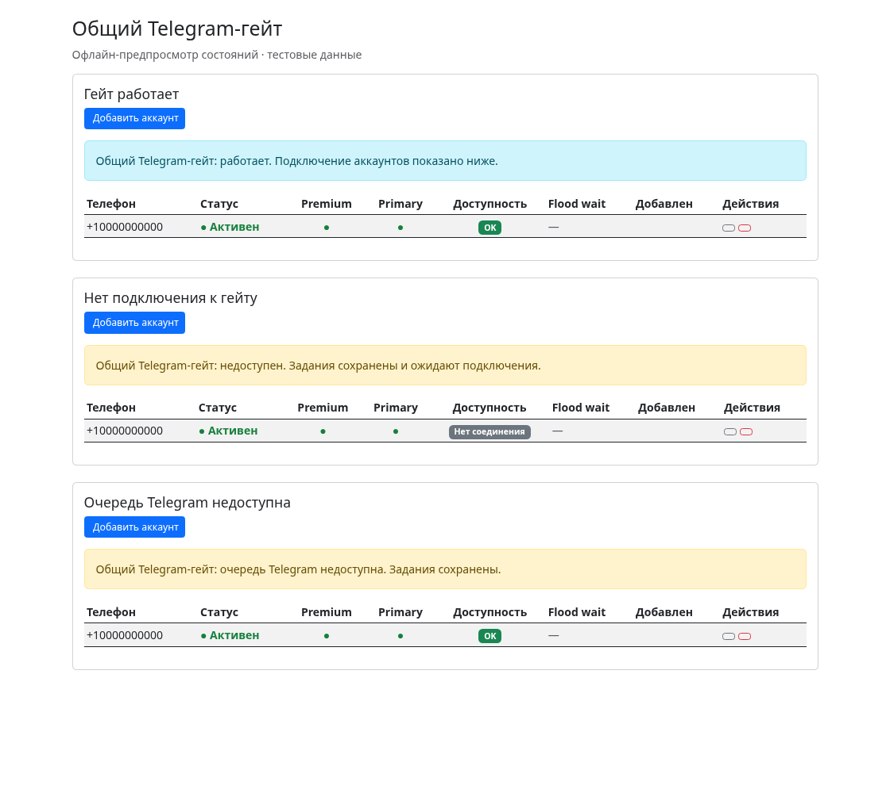

# Shared Telegram gateway

Two projects keep separate SQLite databases and worker processes. The gateway owns
Telegram accounts, live connections, rate limits and resolve backoff. Project tokens
grant access only to explicitly attached accounts. Each project has its own primary
account, collection cursor, filters, schedules and content.

Since #1868 the gateway is a session owner behind the relay
(`tg_agent/telegram/relay.py`), the same mechanism a local worker daemon uses for
the CLI: one process holds the authorized connection, everyone else sends raw
MTProto requests over a loopback socket and parses the raw answers. A project's
worker and CLI build an ordinary `ClientPool(relay=...)` on the gateway's relay, so
every command runs the native code path — there is no gateway-specific operation
protocol, no HTTP server and no operation queue.

## Connect projects

Configure Telegram API credentials and the original session encryption key in the
first project. Stop that project's worker before the initial enrollment:

```sh
tg-agent global enable --account +10000000000
# In the second project, using the same TG_AGENT_GLOBAL_DIR:
tg-agent global enable --account +10000000000
tg-agent worker
```

`--account` is repeatable. Enrollment creates the private gateway key and pins its
interpreter/module installation. Later projects use the enrolled credentials and key;
they do not supply the gateway key. The default root is `~/.tg-agent`; set
`TG_AGENT_GLOBAL_DIR` to relocate it. The gateway relay binds only to 127.0.0.1 and
publishes its dynamic port and relay protocol version in `gateway.endpoint.json` after
startup. Concurrent callers use a process lock.

The version 2 marker contains the project UUID, gateway root and private token-file
reference. It does not redirect `database.path` or contain a token/session. Session
imports decrypt with the source key and re-encrypt with the gateway key. Project
account rows contain safe metadata and stable numeric-ID/UUID mappings, with blank
session strings. Gateway directories are 0700 and secret files are 0600.

```sh
tg-agent global status
tg-agent account attach +10000000000
tg-agent account detach +10000000000
tg-agent account set-primary 1
tg-agent gateway reply-owner +10000000000 123456789
# Release exclusive automatic reply/ping ownership:
tg-agent gateway reply-owner +10000000000 123456789 --release
```

Account toggle/delete in an enrolled project change that project's grant. Shared
session disable/delete/replacement require explicit `gateway account ... --shared`.
`global disable` requires the project's worker to be stopped; it revokes that project's
grants and preserves project content and shared accounts. Standalone mode remains
available without an enrollment marker. In enrolled mode every Telegram request runs
on the gateway's connection; constructing a local `ClientPool` without the relay is
rejected there.

## Migrate legacy global mode

Owner decision #1724 (2026-10-30): **global auth never implies a global
database.** Legacy text markers no longer redirect anything — a project with a
legacy marker keeps its own database and sessions, and every config load logs
a WARNING saying so (`global status` reports the marker as inert). Sharing
accounts is explicit: `tg-agent global enable --account PHONE` replaces the
legacy marker with a JSON binding. `global migrate` remains for the opposite
direction — adopting the content of a legacy shared database into an
independent project database:

```sh
tg-agent global migrate --project-db /absolute/path/project.db
```

The command copies the entire legacy database; it cannot infer historical project
ownership. The destination must be free or belong to the recorded migration. A private
journal records the source, destination and selected accounts. Consistent SQLite
backups are published only after their connections close and the snapshot is independent
of WAL sidecars. Original DB and backups remain intact. Sessions are re-encrypted,
local IDs are mapped, working project session/API/pending-auth secrets are cleared,
and the marker is replaced last. The independent database path is persisted in config.
Retries resume the recorded migration. A live session owner is reported by PID and
blocks migration; wrong keys and conflicting shared sessions cannot silently replace it.

## Requests, control operations and recovery

A project opens one relay connection with its token. The handshake returns the
phones of the accounts granted to it and the relay protocol version; a gateway of
another version is a hard error asking for `tg-agent gateway restart --shared`.
Raw MTProto only round-trips between equal Telegram TL layers, so every project
sharing the gateway must run the same tg-agent/Telethon version as the gateway.
The gateway runs from the install it was enrolled with; a layer mismatch is
refused with a message naming that interpreter — upgrade the older install, then
restart the gateway.

- **Telegram requests** (`invoke`) run on the gateway's connection of a granted
  account, concurrently, behind the gateway pool's flood guards, watchdog, warm
  caches and resolve backoff. Flood deadlines are shared by every project. Requests
  that would end the shared session (`auth.*`, `account.ResetAuthorization`,
  `account.DeleteAccount`) are refused. Media from other DCs uses the gateway's
  exported senders. The gateway's entity cache preloads each project client, so known
  peers resolve without a network call.
- **Control operations** are relay operations of the same connection: the project
  catalog (`accounts`, `account.update`, `account.detach`, `account.export_session`,
  `account.flood_clear`), readiness (`status`), Code/QR/2FA login (`auth`, the login
  stays in the gateway), automatic-reply ownership (`reply_owner`,
  `reply_owner.check`) and DM events (`events`, `events.ack`, `events.recovery`,
  `events.subscribe`). The administrator token (`gateway-admin.token`) reaches only
  `admin.*` operations: project registration, shared-account import/export/state,
  grants and shutdown. A project token never reaches them, and the administrator
  holds no account.
- **DM events** fan out to authorized projects. The gateway pushes a notice over the
  subscribed connection the moment it journals one, and the project's consumer pulls
  by cursor at once (a 30 s pull is only a safety net); the local archive, journal and
  cursor commit before acknowledgement. Expired seven-day event cursors trigger history
  recovery using the project's catch-up policy, read natively over the relay.
  Automatic pings require the exclusive reply owner.
- **Notification bots** belong to projects again. Bots an older enrollment moved into
  the gateway are handed back whenever a project connects — worker or CLI
  (`bots.export`) — and send natively. Creating or deleting a bot is a BotFather
  conversation that waits for replies, which only the session owner receives as
  updates; it runs on the gateway's client (`botfather.*` relay operations) and only
  its outcome reaches the project.

Projects publish, collect and run every other Telegram command through their own
services, as in standalone mode: there are no artifacts, receipts or operation kinds to
keep in sync with the native code.

## Process control

```sh
tg-agent stop                 # current project's worker
tg-agent restart              # current project's worker
tg-agent gateway start
tg-agent gateway status
tg-agent gateway stop --shared
tg-agent gateway restart --shared
```

Worker records and gateway discovery records are separate. Signals require provenance,
the executable and OS process-start identity; legacy numeric PID files without
ownership metadata are refused. A database-scoped OS lock prevents a second project
worker. Shared restart verifies the pinned installation/configuration before stopping,
then waits for the relay to answer and reports startup failure. Project workers
reconnect to a restarted gateway on their next request. After an upgrade, restart the
gateway once (`tg-agent gateway restart --shared`): an older gateway that does not
serve the relay is refused with that hint instead of being used.

## Acceptance evidence

Offline tests stand in for the gateway's Telegram connection with a stub that answers
raw TL requests. The main scenario starts two actual CLI worker subprocesses through
enrollment, with independent databases/cursors and filters, sharing one gateway
connection. Workers collect through their normal queue paths on the relay. After
project A stops, project B's CLI sends a message through the gateway. Other tests
cover grants and token scopes, control and administrator operations, revoked grants,
DM push delivery and recovery, a project `ClientPool` on the gateway relay, an older
gateway refused with a restart hint, source keys, occupied migration destinations,
interrupted marker commit, active session owners and concurrent gateway startup.

**Live acceptance needs Telegram credentials:** offline results do not prove a real
two-project deployment. Run the two-project scenario against a test account before
relying on it.


