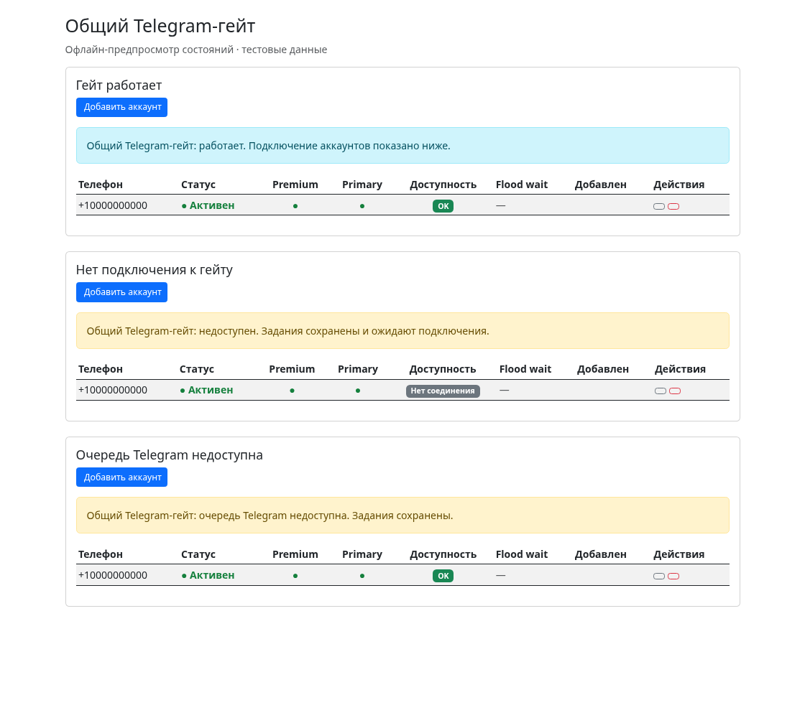

# Shared Telegram gateway

Two projects keep separate SQLite databases and worker processes. The gateway owns
Telegram accounts, live connections, rate limits, resolve backoff and operation receipts.
Project tokens grant access only to explicitly attached accounts. Each project has its
own primary account, collection cursor, filters, schedules and content.

## Connect projects

Configure Telegram API credentials and the original session encryption key in the
first project. Stop that project's worker before the initial enrollment:

```sh
tg-agent global enable --account +10000000000
# In the second project, using the same TG_AGENT_GLOBAL_DIR:
tg-agent global enable --account +10000000000
tg-agent worker
```

`--account` is repeatable. Enrollment creates the private gateway key and pins its
interpreter/module installation. Later projects use the enrolled credentials and key;
they do not supply the gateway key. The default root is `~/.tg-agent`; set
`TG_AGENT_GLOBAL_DIR` to relocate it. The gateway binds only to 127.0.0.1 and publishes
its dynamic port after startup. Concurrent callers use a process lock.

The version 2 marker contains the project UUID, gateway root and private token-file
reference. It does not redirect `database.path` or contain a token/session. Session
imports decrypt with the source key and re-encrypt with the gateway key. Project
account rows contain safe metadata and stable numeric-ID/UUID mappings, with blank
session strings. Gateway directories are 0700 and secret files are 0600.

```sh
tg-agent global status
tg-agent account attach +10000000000
tg-agent account detach +10000000000
tg-agent account set-primary 1
tg-agent gateway reply-owner +10000000000 123456789
# Release exclusive automatic reply/ping ownership:
tg-agent gateway reply-owner +10000000000 123456789 --release
```

Account toggle/delete in an enrolled project change that project's grant. Shared
session disable/delete/replacement require explicit `gateway account ... --shared`.
`global disable` requires the project's worker to be stopped; it revokes that project's
grants and preserves project content and shared accounts. Standalone mode remains
available without an enrollment marker. `--direct` uses the gateway in enrolled mode;
a native local ClientPool constructor is rejected there.

## Migrate legacy global mode

Legacy text markers retain their old interpretation until an explicit migration:

```sh
tg-agent global migrate --project-db /absolute/path/project.db
```

The command copies the entire legacy database; it cannot infer historical project
ownership. The destination must be free or belong to the recorded migration. A private
journal records the source, destination and selected accounts. Consistent SQLite
backups are published only after their connections close and the snapshot is independent
of WAL sidecars. Original DB and backups remain intact. Sessions are re-encrypted,
local IDs are mapped, working project session/API/pending-auth secrets are cleared,
and the marker is replaced last. The independent database path is persisted in config.
Retries resume the recorded migration. A live session owner is reported by PID and
blocks migration; wrong keys and conflicting shared sessions cannot silently replace it.

## Operations and recovery

The authenticated `/v1` protocol has explicit operation kinds and typed inputs.
The existing TelegramActionService contracts are transported through the gateway,
including history, search, profiles, dialogs, statistics, topics, participants,
messages/actions, chat administration and media. Code/QR/2FA login stays in the gateway.
Publishing and photo tasks upload scoped artifacts, preserve filenames, albums,
scheduling and reply targets. BotFather and notification operations run in the gateway;
new notification bot tokens are encrypted there. External speech/image/LLM providers
run in projects. Large result lists are retrieved in pages of at most 100 items.

Each operation has a persisted project request UUID and immutable payload. The gateway
journals `(project_id, request_id)` and alternates projects between operations/history
pages. Existing ClientPool gates, watchdog, warm caches and backoff run inside the
gateway. Native actions borrow the connected client instead of creating force-native
connections. Flood deadlines are shared. Uncertain writes are never automatically
replayed; pipeline publication exposes the existing uncertain-delivery state. Intent
contexts cover queued commands, pipeline actions, publication, photo items and pings.

Collection commits a page, derived statistics/reactions and its cursor in one project
transaction. DM events fan out to authorized projects; local archive/journal/cursor
commit before acknowledgement. Expired seven-day event cursors trigger history
recovery using project catch-up policy. Automatic pings require the exclusive owner.

Artifacts are project-scoped, capped at 128 MiB and expire after 24 hours. Upload
identities survive retries; changed content cannot replace a prior upload identity.
A background cleanup removes expired files and abandoned staging directories.

## Process control

```sh
tg-agent stop                 # current project's worker
tg-agent restart              # current project's worker
tg-agent gateway start
tg-agent gateway status
tg-agent gateway stop --shared
tg-agent gateway restart --shared
```

Worker records and gateway discovery records are separate. Signals require provenance, the executable and OS process-start identity; legacy
numeric PID files without ownership metadata are refused. A database-scoped OS lock prevents a second project
worker. Shared restart verifies the pinned installation/configuration before stopping,
then waits for readiness and reports startup failure. Project code-update hooks manage
only the project's worker. CLI/Web status separates gateway HTTP availability,
dispatcher readiness and permitted-account connections.

## Acceptance evidence

Offline tests use a local Telegram transport. The main scenario starts two actual
CLI worker subprocesses through enrollment, with independent databases/cursors and
filters. Workers collect through their normal queue paths. After project A stops,
project B performs another Telegram command. A separate test exercises the production
LiveTelegramAccess/ClientPool cache and verifies one connected client, normalized
reads, DM fan-out and file publication. No test manually inserts collected posts in
the CLI-worker acceptance scenario.

Additional checks cover rollback of a failed page, replay/uncertainty, grants, scoped
artifacts, shared FloodWait, DM archive delivery/recovery, source keys, occupied migration
destinations, interrupted marker commit, active session owners, concurrent gateway
startup, native-client refusal and CLI command inventory.

Final repository verification is recorded in PR #1715:

```sh
ruff check tg_agent/ tests/ conftest.py
python -m pytest tests/ -q -m 'not aiosqlite_serial' -n 2
python -m pytest tests/ -q -m aiosqlite_serial -n 2 --dist=loadfile
```

**Live acceptance is blocked:** this environment has neither Telegram API credentials
nor a configured test account/chats. Offline results do not prove a successful real
Telegram deployment or every live user-surface effect. The overall task must not be
marked fully accepted until the requested live two-project scenario and capability
checks pass. CI links and final offline counts belong to the PR's final-commit evidence.

Existing notification bot tokens are imported into encrypted, project-scoped gateway
storage before local token fields are cleared. Bot preferences remain independent
between projects.


